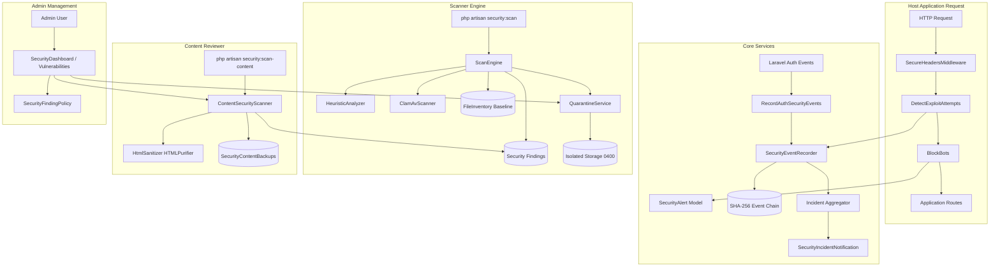

# Laravel Sentinel Package - Dependency Map & Interaction Matrix

## 1. System Dependency Graph

## 2. Framework Version Matrix & Compatibilities

| Framework Feature | Laravel 10.x | Laravel 11.x | Laravel 12.x | Package Adaptation Strategy |
| :--- | :--- | :--- | :--- | :--- |
| **Middleware Registration** | `app/Http/Kernel.php` (`$middleware`, `$middlewareGroups`, `$routeMiddleware`) | `bootstrap/app.php` (`withMiddleware`) | `bootstrap/app.php` (`withMiddleware`) | Package registers middleware aliases automatically in `SecurityServiceProvider`. Users can append to global or web stack in both Kernel and `bootstrap/app.php`. |
| **Service Providers** | `config/app.php` (`providers` array) | `bootstrap/providers.php` | `bootstrap/providers.php` | Full Composer package auto-discovery in `extra.laravel.providers`. |
| **Console Scheduling** | `app/Console/Kernel.php` (`schedule`) | `routes/console.php` (`Schedule::command`) | `routes/console.php` (`Schedule::command`) | Package provides schedule helper or documented entries for `Schedule::command('security:scan')->...`. |
| **Process Execution** | `symfony/process` v6.x | `symfony/process` v7.x | `symfony/process` v7.x | Uses standard Symfony `Process` API compatible across v6 and v7. |
| **HTML Sanitizer** | `ezyang/htmlpurifier` ^4.17 | `ezyang/htmlpurifier` ^4.18 | `ezyang/htmlpurifier` ^4.18 | Requires `ezyang/htmlpurifier: ^4.17|^4.18` in `composer.json`. |

## 3. Host Application Decoupling Matrix

1. **User Model**:
   - Original code: Directly imports `App\Models\User`.
   - Package code: Resolves `config('security.auth.user_model', config('auth.providers.users.model', 'App\\Models\\User'))` via dynamic Eloquent relationships.
2. **Database Foreign Keys**:
   - Original migrations: `$table->foreignId('user_id')->nullable()->constrained('users')->nullOnDelete();`.
   - Package migrations: Checks if user table exists and uses configurable foreign key / constrained table definition without failing on non-standard setups.
3. **Content Scanning Models**:
   - Original code: Hardcoded `public const MODELS = ['blogs' => Blog::class, ...]`.
   - Package code: Config-driven `config('security.content_sources')` with model class or direct DB table fallbacks.
4. **Email Notifications**:
   - Original code: Hardcoded email addresses.
   - Package code: Configured via `config('security.notifications.mail_to')` and `SECURITY_ALERT_EMAILS` environment variable.